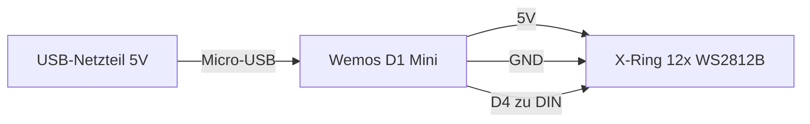

# 🔆 Solar-Ampel – Fronius SolarWeb Anzeige mit ESP8266 & WS2812B LED-Ring

Ein kleines IoT-Projekt: Ein **Wemos D1 Mini (ESP8266)** holt alle 4 Minuten die Live-Daten deiner PV-Anlage von der **Fronius Solar.web Public-Display-API** und zeigt sie auf einem **12er WS2812B LED-Ring (X-Ring)** an. Tagsüber leuchtet die Ampel, nachts schaltet sie sich automatisch ab (Sonnenauf-/untergang ± 30 Minuten). Updates laufen nach dem ersten Flashen kabellos per OTA.

---

## ✨ Was die Ampel anzeigt

| Anzeige | Bedeutung |
|---|---|
| 🟩 Alle 12 LEDs grün | Mehr als 1 kW Einspeisung ins Netz **und** Batterie ≥ 98 % |
| 🟦 1–12 LEDs blau | Batterieladestand (jede LED ≈ 8,3 %), Bereich 71–100 % |
| 🟧 LEDs orange | Batterieladestand, Bereich 31–70 % |
| 🟥 LEDs rot | Batterieladestand ≤ 30 % |
| 🟥 Eine einzelne LED | Fehler: kein WLAN oder API/JSON-Fehler (bleibt bis zum nächsten erfolgreichen Abruf) |
| ⬛ Aus | Nachts (Sonnenaufgang −30 min bis Sonnenuntergang +30 min) |

Beim Start rotiert eine blaue LED, bis die WLAN-Verbindung steht.

---

## 🧰 Hardware (Teileliste)

| Teil | Hinweis |
|---|---|
| Wemos D1 Mini (ESP8266) | Beliebige gängige Variante (ESP-12F basiert) |
| X-Ring: 12× WS2812B RGB LED-Ring | z. B. „Wemos X-Ring 12 Bits WS2812B“ |
| Micro-USB-Kabel + USB-Netzteil | ≥ 1 A empfohlen |
| 3 Jumper-Kabel (weiblich-weiblich) | oder direkt verlötet |
| Optional: Widerstand 330–470 Ω | als Schutz in der Datenleitung |

---

## 🔌 Verkabelung

Es werden nur **drei Leitungen** benötigt:

| D1 Mini | X-Ring |
|---|---|
| 5V | 5V |
| GND | GND / 5VGND |
| D4 | DIN (optional über 330–470 Ω) |



**Hinweise:**

- Der D1 Mini wird per USB versorgt und speist den Ring über den 5V-Pin. 12 LEDs bei Helligkeit 50 ziehen das problemlos.
- Datenleitung kurz halten (< 30 cm) und gemeinsamen GND-Bezugspunkt verwenden.
- **D4 = GPIO2** ist der Pin der Onboard-LED und muss beim Boot HIGH sein. Das funktioniert mit WS2812B (hochohmiger Eingang), aber die erste LED kann beim Einschalten kurz aufflackern – das ist harmlos. Wer das vermeiden will, nutzt D2, D1, D5 oder D7 und passt `LED_PIN` im Sketch an.
- Falls der Ring dauerhaft flackert: 3,3 V Datenpegel an 5 V-LEDs ist grenzwertig. Abhilfe schafft ein Level-Shifter (74AHCT125) oder die Speisung des Rings mit ca. 4,3 V.

---

## 💻 Software-Setup von null

### 1. Arduino IDE installieren

Arduino IDE 2.x von [arduino.cc](https://www.arduino.cc/en/software) herunterladen und installieren.

### 2. ESP8266-Boardunterstützung hinzufügen

1. **Datei → Einstellungen → Zusätzliche Boardverwalter-URLs** eintragen:
   ```
   https://arduino.esp8266.com/stable/package_esp8266com_index.json
   ```
2. **Werkzeuge → Board → Boardverwalter** öffnen, nach `esp8266` suchen und **„esp8266 by ESP8266 Community“** installieren.

### 3. Bibliotheken installieren

**Sketch → Bibliothek einbinden → Bibliotheken verwalten**, dann installieren:

| Bibliothek | Wichtig |
|---|---|
| **Adafruit NeoPixel** | aktuelle Version |
| **ArduinoJson** | **Version 7.x ist erforderlich** (der Sketch nutzt `JsonDocument`) |
| **Dusk2Dawn** | für Sonnenauf-/untergangsberechnung |

`ArduinoOTA` ist bereits Teil des ESP8266-Core, keine extra Installation.

### 4. Board einstellen

**Werkzeuge → Board → LOLIN(WEMOS) D1 R1 & mini** auswählen (bzw. „Wemos D1 mini“).

---

## ⚙️ Konfiguration

Im Sketch (`solar_ampel/solar_ampel.ino`) oben eintragen:

```cpp
const char* ssid = "DEIN_WLAN_NAME";
const char* password = "DEIN_WLAN_PASSWORT";

const char* publicDisplayUrl = "https://www.solarweb.com/ActualData/GetCompareDataForPublicDisplay?PublicDisplayToken=DEIN_TOKEN";
```

- **PublicDisplayToken:** In [solarweb.com](https://www.solarweb.com) dein PV-System öffnen und die **öffentliche Anzeige (Public Display)** aktivieren. Der freigegebene Link enthält den `PublicDisplayToken` – nur dieser Token, keine Login-Daten, wird für die API genutzt.
- **Standort:** `latitude`/`longitude` des Anlagenstandorts (z. B. aus Google Maps: rechter Klick → Koordinaten kopieren).
- **Zeitzone:** `timeZone` als **Standardzeit ohne Sommerzeit** eintragen (Österreich/Deutschland: `1`).

---

## 🚀 Flashen & Starten

1. D1 Mini per USB anschließen, unter **Werkzeuge → Port** den richtigen COM-Port wählen.
2. Sketch hochladen (**Strg+U**).
3. Beim Start rotiert eine blaue LED, bis WLAN steht – danach holt die Ampel sofort die ersten Daten.

**Debugging:** Seriellen Monitor mit **115200 Baud** öffnen. Für den ersten Test optional `Serial.println(payload);` in `fetchAndDisplayData()` einbauen, um die Rohdaten der API zu sehen (hinterher wieder entfernen).

## 📶 Updates per OTA (kabellos)

Nach dem ersten USB-Flash erscheint das Gerät als **„Solar-Ampel“** in der IDE unter **Werkzeuge → Port** (Abschnitt Netzwerk-Ports). Alle weiteren Updates laufen dann über WLAN – ganz ohne Kabel.

---

## 🛰️ Datenquelle

Die Ampel ruft alle 4 Minuten auf:

```
https://www.solarweb.com/ActualData/GetCompareDataForPublicDisplay?PublicDisplayToken=DEIN_TOKEN
```

Beispielantwort (gekürzt):

```json
{
  "IsOnline": true,
  "P_Grid": 43.4,
  "P_Load": -6420.8,
  "P_Batt": 1976.2,
  "SOC": 62.9,
  "P_PV": 4401.2
}
```

- **`P_Grid`**: positiv = Bezug aus dem Netz, **negativ = Einspeisung** ins Netz
- **`SOC`**: Batterieladestand in Prozent

## 🛠️ Fehlerbehebung

| Problem | Lösung |
|---|---|
| Ring bleibt dunkel | Verkabelung prüfen (häufigster Fehler: 5V/GND vertauscht), 5V am Ring messen |
| Eine rote LED leuchtet | WLAN-Daten/Token prüfen, Seriellen Monitor anschauen |
| Farben passen nicht (R/B vertauscht) | Im Sketch `NEO_GRB` gegen `NEO_RGB` tauschen |
| Erste LED blitzt beim Einschalten auf | Normal bei D4/GPIO2 (Boot-Pegel), harmlos |
| Ring flackert dauerhaft | Datenleitung kürzen oder Level-Shifter (74AHCT125) verwenden |

---

## 📁 Projektstruktur

```
├── README.md                 Diese Anleitung
├── LICENSE                   MIT-Lizenz
└── solar_ampel/
    └── solar_ampel.ino       Der Sketch
```

## 📄 Lizenz

Dieses Projekt steht unter der [MIT-Lizenz](LICENSE).
